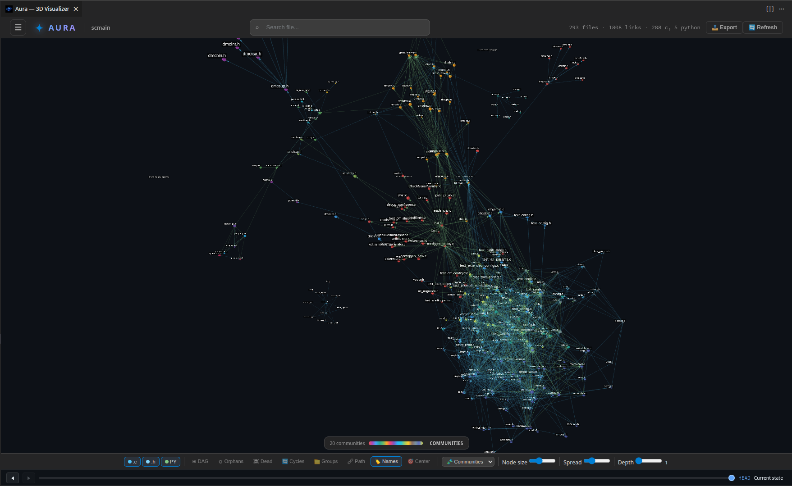

  

<h1 align="center">✦ Aura Visualizer</h1>

  <strong>Visualize your codebase in 3D directly inside VS Code</strong> 
  Interactive dependency graph &bull; Force-directed layout &bull; AI-ready

  
  
  

  

---

## Features

### 3D Force-Directed Graph

Files become interactive 3D nodes, dependencies become edges. The graph uses physics simulation to arrange nodes organically — highly connected files cluster together, isolated files drift to the periphery.

- **Node size** scales with lines of code (cube root)
- **Edge colors** reflect dependency type (import, include, function call, etc.)
- **Directional arrows** show dependency direction
- **Animated particles** flow along highlighted paths

### Multi-Language Support

Powered by **Tree-sitter** AST parsing (WASM) for accurate, structural code analysis.

| Language | Extensions | Color |
|----------|-----------|-------|
| C source | `.c` | 🔷 Light blue |
| C header | `.h` | 📘 Sky blue |
| JavaScript | `.js`, `.jsx` | 🟡 Yellow |
| TypeScript | `.ts`, `.tsx` | 🔵 Blue |
| Python | `.py` | 🟢 Green |
| Java | `.java` | 🔴 Red |
| Go | `.go` | 🩵 Cyan |
| Rust | `.rs` | 🟠 Orange |
| CSS | `.css` | 🟣 Purple |
| HTML | `.html` | 🟧 Coral |

Cross-file **function calls** are detected for C, JS/TS, Python, Java, Go, and Rust.
**Inheritance edges** (`extends` / `implements`) are detected for JS/TS, Python, Java, Go (struct embedding), and Rust (trait impl).
Language filter buttons are **dynamic** — only languages present in the current analysis are shown.

### Interactive Exploration

| Action | Effect |
|--------|--------|
| **Click** | Select node, show detail panel, focus camera |
| **Double-click** | Open file in VS Code editor |
| **Right-click** | Pin focus — isolate file + neighbors up to N depth |
| **Shift+Right-click** | Blast radius — show impact (all dependents) with depth coloring |
| **Shift+Click** | Multi-select — aggregate stats for multiple files |
| **Scroll** | Zoom in / out |
| **Drag** | Rotate the 3D view |
| **Background click** | Clear all selections |

### Heatmap Modes

Color every node by a metric to spot hotspots at a glance. Press `H` to cycle through:

| Mode | Description |
|------|-------------|
| **Off** | Color by programming language |
| **Complexity** | Cyclomatic complexity (branching, loops) |
| **Fan-in** | How many files depend on this file |
| **Fan-out** | How many files this file depends on |
| **Lines of Code** | File size |
| **Last Modified** | Git commit recency |
| **Communities** | Architectural modules detected by Louvain algorithm |

Blue = low, Red = high. A legend displays the value range.

### Community Detection

The **Communities** heatmap mode uses the Louvain algorithm to detect architectural modules by dependency coupling — not directory structure. Each community gets a unique color and is named after its hub file (highest fan-in).

A **floating palette** appears on the right, listing all communities with:
- Color swatch and hub name
- File count per community
- Click to toggle individual communities on/off
- **All** / **None** buttons for batch selection

Unselected communities are grayed out (nodes + links), just like pin focus.

### Blast Radius

**Shift+Right-click** on any file to see its impact radius — all files that transitively depend on it. Nodes are colored by depth of impact:

| Depth | Color |
|-------|-------|
| Source | White (orange glow halo) |
| 1 | Red |
| 2 | Orange |
| 3 | Yellow |
| 4 | Yellow-green |
| 5 | Green |

Use the **Depth slider** (1–5) or keys `1`–`5` to control the blast radius depth.

### File Explosion

Expand any file into its internal symbols — functions, structs, enums, macros. Each symbol becomes its own node, connected to the parent file. Double-click a symbol to jump to that exact line in the editor.

### Path Finder

Find the shortest dependency path between any two files. Click **Path** in the toolbar then select source and destination. The path lights up with animated particles.

### Dead Code Detection ☠️

Press `X` or click the **Dead Code** button. Files with unused exports are highlighted in orange-to-red gradient. The detail panel lists each unused export with a ⚠️ label.

### Circular Dependencies 🔄

Press `C` or click the **Cycles** button. All nodes involved in circular dependency chains are highlighted in orange. The detail panel shows the full cycle paths.

### Orphan Detection

Press `O` to highlight isolated files (zero incoming and outgoing dependencies) in red. Useful for finding dead files that nothing references.

### DAG Mode

Press `D` to switch from physics-based layout to a hierarchical top-down **Directed Acyclic Graph** layout. Entry-point files float to the top, leaf dependencies sink to the bottom.

### Directory Clustering

Press `G` to group files by directory. Directories become translucent spheres containing their files. Click a cluster to expand or collapse it.

### Multi-Selection

Hold `Shift` and click multiple nodes to select a group. The detail panel shows:

- Combined LOC and average complexity
- Language breakdown
- Internal links between selected files
- List of all selected files

### Time Machine ⏳

Navigate your project's git history commit by commit. A timeline bar at the bottom lets you scrub through commits. Changed files are highlighted in yellow at each step.

| Control | Action |
|---------|--------|
| Timeline slider | Jump to any commit |
| `←` / `→` arrows | Step through commits |
| Prev / Next buttons | Navigate history |
| `Escape` | Return to HEAD |

### Search

Type in the search box (2+ characters) to find files by name or path. Results appear in a live dropdown — click to navigate.

### File Explorer Panel

Toggle a tree-view panel showing all files organized by directory. Click a file to select it in the graph.

### Filter by Language

Toggle language buttons in the filter bar to show/hide files by type. Multiple languages can be active simultaneously.

### Adjustable Controls

| Slider | Effect |
|--------|--------|
| **Node Size** | Scale the visual radius of all nodes |
| **Spread** | Adjust repulsion force between nodes |
| **Depth** (1–5) | Set how many neighbor levels to show when pinning focus |

### Incremental Updates

When `autoRefresh` is enabled, the graph updates automatically whenever you save a file — no manual re-scan needed.

---

## Getting Started

1. Install the extension from the VS Code Marketplace (or load the `.vsix`)
2. Open a project folder in VS Code
3. Press `Ctrl+Shift+A` (or `Cmd+Shift+A` on Mac)
4. Explore your codebase in 3D

You can also open the visualizer from the **Aura** icon in the Activity Bar or via the Command Palette → *Aura: Visualize Codebase*.

---

## Commands

| Command | Shortcut | Description |
|---------|----------|-------------|
| Aura: Visualize Codebase | `Ctrl+Shift+A` | Open the 3D visualization |
| Aura: Refresh Visualization | — | Re-analyze the workspace |
| Aura: Focus Current File | — | Highlight the active editor file in the graph |
| Aura: Blast Radius | — | Show blast radius for the active file |
| Aura: Export Graph for AI | — | Export graph data as JSON |

## Keyboard Shortcuts (in graph)

| Key | Action |
|-----|--------|
| `F` | Fit to view / recenter |
| `L` | Toggle node labels |
| `G` | Toggle directory groups |
| `H` | Cycle heatmap modes |
| `P` | Toggle path-finding mode |
| `D` | Toggle DAG layout |
| `O` | Highlight orphan files |
| `X` | Toggle dead code visualization |
| `C` | Toggle circular dependencies |
| `1`–`5` | Set pinned focus depth |
| `←` `→` | Timeline: previous / next commit |
| `Escape` | Reset all — clear selections, heatmaps, timeline |

---

## AI Integration

Aura includes a built-in **MCP server** (Model Context Protocol) and a **Graph Database** so AI assistants can query your codebase structure programmatically.

### Graph Database

Every analysis is persisted to a local SQLite database (`.aura/graph.db` via sql.js/WASM). This enables fast structural queries without re-parsing.

### MCP Server

The MCP server exposes your codebase graph to AI tools via stdio transport. It registers automatically in `.vscode/mcp.json` on first run.

**Resources:**

| URI | Description |
|-----|-------------|
| `aura://overview` | Architecture overview — file counts, LOC, complexity by language |
| `aura://nodes` | All files with full metrics |
| `aura://node/{id}` | Detail for a specific file — symbols, dependencies, dependents |

**Tools:**

| Tool | Parameters | Description |
|------|-----------|-------------|
| `find_dependencies` | `file`, `depth` | Transitive dependency tree |
| `find_dependents` | `file`, `depth` | Impact analysis — blast radius with risk levels |
| `find_path` | `from`, `to` | Shortest dependency path between two files |
| `find_cycles` | — | All circular dependency cycles |
| `find_dead_code` | — | Unused exports across the codebase |
| `get_hotspots` | `limit`, `sort_by` | Most complex / impactful files |
| `search_symbols` | `query`, `kind` | Find functions, classes, exports by name |
| `get_architecture` | — | High-level overview by language |
| `get_communities` | — | Architectural modules detected by Louvain algorithm |

---

## Settings

| Setting | Default | Description |
|---------|---------|-------------|
| `auraVisualizer.excludePaths` | `["node_modules", ".git", "dist", "build", "out", "__pycache__"]` | Directories to exclude from analysis |
| `auraVisualizer.maxFiles` | `500` | Maximum number of files to analyze |
| `auraVisualizer.autoRefresh` | `true` | Auto-refresh on file save |

---

## Edge Types

| Type | Color | Source |
|------|-------|--------|
| `include` | Light blue | C `#include "file.h"` |
| `system-include` | Light blue (dim) | C `#include <stdlib.h>` |
| `import` | Yellow | JS/TS `import` |
| `require` | Yellow (dim) | CommonJS `require()` |
| `dynamic-import` | Yellow (faint) | `import()` expressions |
| `function-call` | Green | Cross-file function calls (C, JS/TS, Python, Java, Go, Rust) |
| `extends` | Pink | Class/struct inheritance |
| `implements` | Purple | Interface / trait implementation |
| `script` | Orange | HTML `<script src>` |
| `stylesheet` | Purple | HTML `<link rel="stylesheet">` |
| `css-import` | Purple (dim) | CSS `@import` |
| `css-url` | Purple (faint) | CSS `url()` references |

---

## License

MIT
