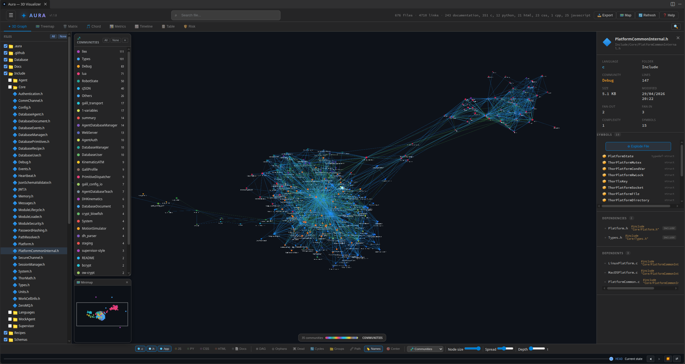

<h1 align="center">✦ Aura Visualizer</h1>

  <strong>Visualize your codebase in 3D directly inside VS Code</strong> 
  Interactive dependency graph &bull; Force-directed layout &bull; AI-ready

  
  
  

  

---

## Features

### 3D Force-Directed Graph

Files become interactive 3D nodes, dependencies become edges. The graph uses physics simulation to arrange nodes organically — highly connected files cluster together, isolated files drift to the periphery.

- **Node size** scales with lines of code (cube root)
- **Edge colors** reflect dependency type (import, include, function call, etc.)
- **Directional arrows** show dependency direction
- **Animated particles** flow along highlighted paths

### Multi-Language Support

Powered by **Tree-sitter** AST parsing (WASM) for accurate, structural code analysis.

| Language | Extensions | Color |
|----------|-----------|-------|
| C source | `.c` | 🔷 Light blue |
| C header | `.h` | 📘 Sky blue |
| C++ | `.cpp`, `.cc`, `.cxx`, `.hpp`, `.hxx`, `.hh` | 🔹 Steel blue |
| JavaScript | `.js`, `.jsx` | 🟡 Yellow |
| TypeScript | `.ts`, `.tsx` | 🔵 Blue |
| Python | `.py` | 🟢 Green |
| Java | `.java` | 🔴 Red |
| Go | `.go` | 🩵 Cyan |
| Rust | `.rs` | 🟠 Orange |
| Kotlin | `.kt`, `.kts` | 🟣 Purple |
| Ruby | `.rb` | ❤️ Red |
| Swift | `.swift` | 🟥 Coral |
| CSS | `.css` | 🟣 Purple |
| HTML | `.html` | 🟧 Coral |
| Documentation | `.md`, `.markdown`, `.txt`, `.rst` | 📄 Slate |

Cross-file **function calls** are detected for C, C++, JS/TS, Python, Java, Go, Rust, Kotlin, Ruby, and Swift.
**Inheritance edges** (`extends` / `implements`) are detected for JS/TS, Python, Java, Go (struct embedding), Rust (trait impl), Kotlin, and Swift (protocol conformance).
Language filter buttons are **dynamic** — only languages present in the current analysis are shown.

### Interactive Exploration

| Action | Effect |
|--------|--------|
| **Click** | Select node, show detail panel, focus camera |
| **Double-click** | Open file in VS Code editor |
| **Right-click** | Pin focus — isolate file + neighbors up to N depth |
| **Shift+Right-click** | Blast radius — show impact (all dependents) with depth coloring |
| **Shift+Click** | Multi-select — aggregate stats for multiple files |
| **Scroll** | Zoom in / out |
| **Drag** | Rotate the 3D view |
| **Background click** | Clear all selections |

### Heatmap Modes

Color every node by a metric to spot hotspots at a glance. Press `H` to cycle through:

| Mode | Description |
|------|-------------|
| **Off** | Color by programming language |
| **Complexity** | Cyclomatic complexity (branching, loops) |
| **Fan-in** | How many files depend on this file |
| **Fan-out** | How many files this file depends on |
| **Lines of Code** | File size |
| **Churn (commits)** | Git commit count per file — requires Time Travel scan |
| **Last Modified** | File modification time (most recently changed = red) |
| **Communities** | Architectural modules detected by Louvain algorithm |

Blue = low, Red = high. A legend displays the value range.

### Community Detection

The **Communities** heatmap mode uses the Louvain algorithm to detect architectural modules by dependency coupling — not directory structure. Each community gets a unique color and is named after its hub file (highest fan-in).

A **floating palette** appears on the right, listing all communities with:
- Color swatch and hub name
- File count per community
- Click to toggle individual communities on/off
- **All** / **None** buttons for batch selection

Unselected communities are grayed out (nodes + links), just like pin focus.

### Blast Radius

**Shift+Right-click** on any file to see its impact radius — all files that transitively depend on it. Nodes are colored by depth of impact:

| Depth | Color |
|-------|-------|
| Source | White (orange glow halo) |
| 1 | Red |
| 2 | Orange |
| 3 | Yellow |
| 4 | Yellow-green |
| 5 | Green |

Use the **Depth slider** (1–5) or keys `1`–`5` to control the blast radius depth.

### File Explosion

Expand any file into its internal symbols — functions, structs, enums, macros. Each symbol becomes its own node, connected to the parent file. Double-click a symbol to jump to that exact line in the editor.

### Path Finder

Find the shortest dependency path between any two files. Click **Path** in the toolbar then select source and destination. The path lights up with animated particles.

### Dead Code Detection ☠️

Press `X` or click the **Dead Code** button. Files with unused exports are highlighted in orange-to-red gradient. The detail panel lists each unused export with a ⚠️ label.

### Risk Map 🛡️

Open the **🛡️ Risk** tab for a codebase health dashboard built on a transparent, explainable risk score:

`risk = 100 × (0.30·complexity + 0.20·fan-in + 0.10·fan-out + 0.15·cycle + 0.15·dead-code + 0.10·churn)`

Complexity, fan-in, fan-out and churn are **percentile ranks inside your repository** (0 = lowest file, 1 = highest), so a score is a standing relative to *your* codebase rather than an absolute threshold — a 72 means the same thing in a 50-file project and in a 5 000-file one. Cycle and dead-code are ratios by nature.

- **Codebase Health** — overall health score (`100 − average risk`), plus the most risky and most connected files
- **Risk Distribution** — high / medium / low buckets with percentages
- **High / Medium / Low files** — collapsible lists (▼/▶ arrows); each file states *why* it scores that way ("changed 29 times in 90 days (top 1%)", "12 files depend on it"), with the full breakdown on hover. Click a file to select it and focus it in the 3D graph.
- **History window** — pick 30 / 90 / 365 days of git history; it drives churn, scoring and the explanations. Also available as the `auraVisualizer.riskWindow` workspace setting, shared with the status bar and the MCP `get_hotspots` tool
- **🛡️ Status bar** — the risk of the file you are editing (`Risk 72 · top 8%`, written reasons in the tooltip); it switches to **`⚠ N hotspots in your changes`** when your working tree touches high-risk files. Click to jump to the file in the Risk tab
- **📈 Risk Trend** — average complexity over git history (structural risk proxy)
- **🔥 Recently Hot** — files modified most in the last 30 days
- **📊 Churn × Complexity** — scatter matrix (log scale) spotting files that are both complex and heavily churned (red = hot)
- **👤 Bus Factor** — files touched by a single developer (≥ 3 commits in the window)
- **📤 Export Report** — writes a Markdown report to `.aura/risk-report.md`, reasons included

Risk buckets: **High ≥ 66**, **Medium 33–65**, **Low < 33**. Churn is measured as commits per file and requires the git **Time Travel** scan.

### Git Working Tree ✏️

Aura reads `git status` and shows what you are working on right now:

- **Dirty rings** — files with uncommitted changes wear a thin amber ring in the 3D graph; the detail panel adds a **Git** line with the exact state (modified / staged / untracked / renamed / conflicted)
- **✏️ Dirty filter** — toolbar button showing only files with uncommitted changes (nodes *and* links)
- **Query flag** — `dirty` works in the query bar: `dirty AND complexity > 20`
- **Status bar alert** — when your changes touch high-risk files, the status bar switches to `⚠ N hotspots in your changes` (see Risk Map)

Everything refreshes automatically on save (debounced, no shell involved).

### Circular Dependencies 🔄

Press `C` or click the **Cycles** button. All nodes involved in circular dependency chains are highlighted in orange. The detail panel shows the full cycle paths.

### Orphan Detection

Press `O` to highlight isolated files (zero incoming and outgoing dependencies) in red. Useful for finding dead files that nothing references.

### DAG Mode

Press `D` to switch from physics-based layout to a hierarchical top-down **Directed Acyclic Graph** layout. Entry-point files float to the top, leaf dependencies sink to the bottom.

### Directory Clustering

Press `G` to group files by directory. Directories become translucent spheres containing their files. Click a cluster to expand or collapse it.

### Multi-Selection

Hold `Shift` and click multiple nodes to select a group. The detail panel shows:

- Combined LOC and average complexity
- Language breakdown
- Internal links between selected files
- List of all selected files

### Minimap 🗺️

Toggle with the **🗺️ Map** button in the toolbar. A floating minimap displays a real-time overview of all nodes, projected from the camera's perspective. The white rectangle shows the current viewport.

- **Rotate** the 3D view — the minimap rotates in sync
- **Drag** inside the minimap — pan the camera in the 3D view
- **Drag the header** — reposition the minimap panel
- **Close** with the ✕ button or toggle the toolbar button

### Time Travel ⏳

Navigate your project's git history commit by commit. A timeline bar at the bottom lets you scrub through commits. Changed files are color-coded: 🟢 green = added, 🔴 pink = removed, 🟡 yellow = modified. Edges follow the same color scheme.

| Control | Action |
|---------|--------|
| Timeline slider | Jump to any commit |
| `←` / `→` arrows | Step through commits |
| Prev / Next buttons | Navigate history |
| `I` | Toggle impact cascade from changed files |
| `Escape` | Return to HEAD |

### Visual Diff Between Commits 🔀

Press `V` or click the **⇄ Compare** button to enter **Compare mode**. A second slider appears — drag both sliders to diff any two commits. Files that changed between those commits are highlighted; unchanged nodes are dimmed. Compare mode shows the cumulative diff across the selected range.

### Search

Type in the search box (2+ characters) to find files by name or path. Results appear in a live dropdown — click to navigate.

### Query Filter 🔍

Filter, highlight, or select files with the built-in **Aura Query Language** — a small boolean DSL evaluated over node metrics.

- Open the query bar with the **🔍 button** (far right of the tab bar) or `Ctrl+K` / `Cmd+K`. It stays hidden until you need it.
- Type an expression such as `complexity > 20 AND fanIn > 5` — matches are highlighted (or filtered / selected, depending on the mode).

**Available fields:**

| Field | Description |
|-------|-------------|
| `complexity` | Cyclomatic complexity |
| `loc` / `linesofcode` | Lines of code |
| `fanin` / `fanout` | Incoming / outgoing dependency counts |
| `size` | File size in bytes |
| `mtime` / `lastmodified` | Last modification time |
| `symbols` / `symbolscount` | Number of extracted symbols |
| `deadexports` | Number of unused (dead) exports |
| `language`, `name`, `path`, `group`, `extension` | String metadata |
| `community` | Detected community name |
| `isorphan`, `isdead`, `incycle`, `ispinned`, `dirty` | Boolean flags (`dirty` = uncommitted git changes) |

**Operators:** `==`, `!=`, `>`, `<`, `>=`, `<=`, `~` (regex), `!~`, `in [ ... ]`, plus `AND` / `OR` / `NOT` and parentheses.

**Examples:**

- `language in [typescript, python]`
- `fanIn > 10 AND complexity > 20`
- `isorphan`
- `dirty AND complexity > 20` — files being edited right now
- `path ~ /src\/.*/`

**Modes:** **Highlight** (dim non-matching files), **Filter** (hide non-matching files), **Select** (multi-select matching files).

**Saved queries:** press **⭐** to save the current expression and **📚** to reopen the saved list (persisted in `.aura/graph.db`).

### File Explorer Panel

Toggle a tree-view panel showing all files organized by directory. Click a file to select it in the graph.

**Directory filtering**: Each directory has a checkbox to show/hide its files in the graph. Use the **All** / **None** buttons at the top for batch selection. Directories are checked by default.

### Filter by Language

Toggle language buttons in the filter bar to show/hide files by type. Multiple languages can be active simultaneously.

### Adjustable Controls

| Slider | Effect |
|--------|--------|
| **Node Size** | Scale the visual radius of all nodes |
| **Spread** | Adjust repulsion force between nodes |
| **Depth** (1–5) | Set how many neighbor levels to show when pinning focus |

### In-App Settings ⚙️

The **⚙️ button** in the tab bar (next to 🔍 Query) opens an in-app settings modal — no need to dig into VS Code settings:

| Control | Effect |
|---------|--------|
| **Risk history window** | 30 / 90 / 365 days of git history — drives the Risk Map, the status bar and hotspots |
| **Mouse rotation speed** | 1 → 5 slider — how fast dragging rotates the 3D view |
| **Link style** | Straight or curved dependency edges (+ curvature amount) |
| **Selected node effect** | Glow halo or bloom post-processing (+ intensity / radius / threshold) |
| **Auto-refresh on save** | Re-analyze changed files automatically |

Changes apply instantly and are saved to your workspace settings. The footer link opens the full `auraVisualizer.*` list.

### Incremental Updates

When `autoRefresh` is enabled, the graph updates automatically whenever you save a file — no manual re-scan needed. Only the changed file is re-parsed and its edges recalculated (O(1) instead of O(N)).

**Instant startup**: The graph is persisted to a local SQLite database (`.aura/graph.db`). On next launch, the cached graph loads instantly while a background re-scan picks up any changes and sends a delta update.

### Function Call Labels

In the detail panel, dependency links of type `function-call` display the actual function name (e.g. `helper()`) next to the target file. A green `×N` badge shows when multiple distinct call sites exist between the same pair of files.

In the 3D Graph, function-call edges have **logarithmic width** scaled to call count, and **hovering an edge** displays a tooltip listing the top 5 caller → callee function pairs.

For **C/C++ projects**, function-call links are only created between files connected via `#include` — preventing false positives between unrelated files that happen to define functions with the same name.

### Documentation in the Graph

Markdown, plain-text and reStructuredText files (`.md`, `.markdown`, `.txt`, `.rst`) are first-class nodes in the graph:

- **Dotted `doc-reference` edges** automatically connect each doc file to the code files it mentions — detected from symbol names (functions, classes, methods, exports) and basename references like `extension.ts`. Doc edges do **not** count toward fan-in / fan-out, so hotspot metrics stay clean.
- A **📄 Docs** filter button in the toolbar toggles documentation nodes on / off (hidden by default to keep the structural view focused).
- Doc content is chunked by heading and indexed in a local **FTS** full-text index — exposed to AI assistants through the `search_docs` MCP tool.

### Symbols in the File Explorer

Files in the side Explorer panel that contain functions or methods show a **chevron** to their left. Click it to reveal an indented list of every function/method in the file (sorted by line number). Click any function to **open the file in the editor and jump to that exact line**.

This turns the Explorer into a fast outline / go-to-symbol navigator across your whole project.

### Tabbed Views

Switch between **8 visualization tabs** for different perspectives on your codebase:

| Tab | Description |
|-----|-------------|
| **✦ 3D Graph** | Interactive 3D force-directed dependency graph (default) |
| **🗺️ Treemap** | Files nested by directory, sized by LOC or complexity, colored by metric. Click to zoom into subdirectories, breadcrumb navigation to zoom out. |
| **🗑️ Matrix** | N×N Dependency Structure Matrix (DSM). Rows and columns are files; a colored cell means a dependency exists. Red cells with ↺ indicate circular dependencies. Group by directory, language, or community. |
| **🎵 Chord** | Chord diagram showing dependency flows between groups (directories, languages, or communities). Ribbon thickness reflects flow volume. Hover to highlight a group and its connections. |
| **📊 Metrics** | Dashboard with bar charts: LOC, complexity, fan-in, fan-out by language and top files. |
| **📈 Timeline** | Line chart showing metric evolution over git history (LOC, file count, avg complexity, total complexity). Requires Time Travel scan. |
| **📋 Table** | Sortable, filterable spreadsheet of all files with LOC, complexity, fan-in/out, symbols, and folder. |
| **🛡️ Risk** | Codebase risk dashboard — health score, risk distribution, churn × complexity matrix, bus factor, and an exportable report |

All tabs share the same live data and update when the graph is refreshed.

---

## Getting Started

1. Install the extension from the VS Code Marketplace (or load the `.vsix`)
2. Open a project folder in VS Code
3. Press `Ctrl+Shift+A` (or `Cmd+Shift+A` on Mac)
4. Explore your codebase in 3D

You can also open the visualizer from the **Aura** icon in the Activity Bar or via the Command Palette → *Aura: Visualize Codebase*.

---

## Commands

| Command | Shortcut | Description |
|---------|----------|-------------|
| Aura: Visualize Codebase | `Ctrl+Shift+A` | Open the 3D visualization |
| Aura: Refresh Visualization | — | Re-analyze the workspace |
| Aura: Focus Current File | — | Highlight the active editor file in the graph |
| Aura: Blast Radius | — | Show blast radius for the active file |
| Aura: Export Graph for AI | — | Export graph data as JSON |

## Keyboard Shortcuts (in graph)

| Key | Action |
|-----|--------|
| `Ctrl+K` | Open the query filter bar |
| `F` | Fit to view / recenter |
| `L` | Toggle node labels |
| `G` | Toggle directory groups |
| `H` | Cycle heatmap modes |
| `P` | Toggle path-finding mode |
| `D` | Toggle DAG layout |
| `O` | Highlight orphan files |
| `X` | Toggle dead code visualization |
| `C` | Toggle circular dependencies |
| `1`–`5` | Set pinned focus depth |
| `V` | Toggle timeline compare mode (dual slider) |
| `I` | Toggle timeline impact cascade |
| `←` `→` | Timeline: previous / next commit |
| `Escape` | Reset all — clear selections, heatmaps, timeline |

---

## AI Integration

Aura includes a built-in **MCP server** (Model Context Protocol) and a **Graph Database** so AI assistants can query your codebase structure programmatically.

### Graph Database

Every analysis is persisted to a local SQLite database (`.aura/graph.db` via sql.js/WASM). This enables fast structural queries without re-parsing.

### MCP Server

The MCP server exposes your codebase graph to AI tools via stdio transport. It registers automatically in `.vscode/mcp.json` on first run.

**Resources:**

| URI | Description |
|-----|-------------|
| `aura://overview` | Architecture overview — file counts, LOC, complexity by language |
| `aura://nodes` | All files with full metrics |
| `aura://node/{id}` | Detail for a specific file — symbols, dependencies, dependents |

**Tools:**

| Tool | Parameters | Description |
|------|-----------|-------------|
| `find_dependencies` | `file`, `depth` | Transitive dependency tree |
| `find_dependents` | `file`, `depth` | Impact analysis — blast radius with risk levels |
| `find_path` | `from`, `to` | Shortest dependency path between two files |
| `find_cycles` | — | All circular dependency cycles |
| `find_dead_code` | — | Unused exports across the codebase |
| `find_unused_functions` | `file`, `include_methods` | Functions/methods never called anywhere |
| `get_hotspots` | `limit`, `sort_by`, `window_days` | At-risk files ranked by the repository-relative risk score (percentile-based) with written reasons; raw metric sorts still available via `sort_by` |
| `search_symbols` | `query`, `kind` | Find functions, classes, exports by name |
| `find_heritage` | `file` | Inheritance and implementation relationships (extends/implements) |
| `get_architecture` | — | High-level overview by language |
| `get_communities` | — | Architectural modules detected by Louvain algorithm |
| `search_docs` | `query`, `limit` | Full-text search across project documentation (Markdown / `.txt` / `.rst`) — returns ranked chunks with file path, section heading, and excerpt |
| `resolve_context` | `task`, `limit` | Ranked list of files most relevant to a natural-language task (deterministic, no LLM) |
| `generate_documentation` | `hotspot_limit` | Full documentation payload: overview, modules, hotspots, cycles, dead code, inter-module links |

---

## Settings

All settings live under `auraVisualizer.*` — the most common ones are also editable in-app via the **⚙️ Settings** button.

| Setting | Default | Description |
|---------|---------|-------------|
| `auraVisualizer.excludePaths` | `["node_modules", ".git", "dist", "build", "out", "__pycache__"]` | Directories to exclude from analysis |
| `auraVisualizer.maxFiles` | `500` | Maximum number of files to analyze |
| `auraVisualizer.autoRefresh` | `true` | Auto-refresh on file save |
| `auraVisualizer.riskWindow` | `90` | Git history window (30 / 90 / 365 days) used by the Risk Map, the status bar and `get_hotspots` |
| `auraVisualizer.rotateSpeed` | `1` | Rotation speed when dragging the 3D graph (1–5, 5 = fastest) |
| `auraVisualizer.linkStyle` | `"straight"` | Edge style in the 3D graph (`straight` / `curved`) |
| `auraVisualizer.linkCurvature` | `0.25` | Curvature amount when `linkStyle` is `curved` (0–1) |
| `auraVisualizer.selectedNodeEffect` | `"glow"` | Selected-node highlight — `glow` halo or `bloom` post-processing |
| `auraVisualizer.bloomStrength` / `bloomRadius` / `bloomThreshold` | `1.2` / `0.6` / `0.0` | Bloom tuning when `selectedNodeEffect` is `bloom` |

---

## Edge Types

| Type | Color | Source |
|------|-------|--------|
| `include` | Light blue | C `#include "file.h"` |
| `system-include` | Light blue (dim) | C `#include <stdlib.h>` |
| `import` | Yellow | JS/TS `import` |
| `require` | Yellow (dim) | CommonJS `require()` |
| `dynamic-import` | Yellow (faint) | `import()` expressions |
| `function-call` | Green | Cross-file function calls (C, C++, JS/TS, Python, Java, Go, Rust, Kotlin, Ruby, Swift) |
| `extends` | Pink | Class/struct inheritance |
| `implements` | Purple | Interface / trait implementation |
| `script` | Orange | HTML `<script src>` |
| `stylesheet` | Purple | HTML `<link rel="stylesheet">` |
| `css-import` | Purple (dim) | CSS `@import` |
| `css-url` | Purple (faint) | CSS `url()` references |
| `doc-reference` | Slate (thin) | Mentions of code symbols / filenames inside `.md` / `.txt` / `.rst` files |

---

## License

MIT
